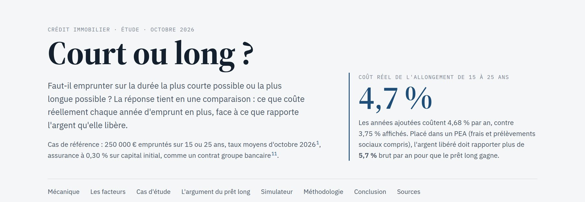

Avec un pote, on a le même débat à chaque fois : pour acheter un logement en France, faut-il emprunter sur la durée la plus courte possible, ou la plus longue ? J'ai donc demandé à Claude de répondre avec de vrais chiffres : [Court ou long ?](https://lyrixx.github.io/duree-de-pret/). L'étude est livrée avec un simulateur.

Pour être honnête, cette étude sert à 90 % à ce débat, et à 10 % à jouer avec Claude, pour montrer qu'il sait bien compter. C'est Claude qui a tout construit.

Oui, même les 34 sources.

Note : ce n'est pas un conseil financier personnalisé. Les chiffres utilisent les taux moyens d'octobre 2026.

## Combien coûte vraiment un prêt long ?

Prenons 250 000 € sur 15 ou 25 ans, à 3,50 % et 3,75 %, avec une assurance à 0,30 % sur le capital initial.

Le prêt sur 25 ans affiche 3,75 %. Mais passer de 15 à 25 ans, c'est comme recevoir 502 € par mois pendant 15 ans, puis rembourser 1 348 € par mois pendant 10 ans de plus. Et ce prêt caché a un vrai taux : **4,68 % par an**.

Emprunter à son futur soi, à 4,7 %.

C'est plus que 3,75 %, pour deux raisons. Le taux sur 25 ans s'applique à tout le capital, et l'assurance court dix ans de plus.

La vraie question, c'est donc : que deviennent les 502 € libérés chaque mois ?

## Et si on place la différence ?

Vous avez sûrement déjà entendu cet argument : « Avec un prêt long, on garde plus d'argent, et on peut le placer à 8 %. »

Avec 8 % garantis dans un PEA, le prêt long gagne : après 25 ans, vous avez 70 408 € de plus, frais et prélèvements sociaux compris.

Garantis. Bien sûr.

Mais 8 %, ce n'est qu'une moyenne. L'étude simule donc 4 000 marchés, avec une volatilité de 15 %. Le prêt long gagne dans 74 % des cas. Dans 1 cas sur 10, il perd plus de 48 000 €. Dans 1 cas sur 10, il gagne plus de 366 000 €.

Et ça ne marche que si vous gardez le logement. Si vous revendez au bout de 8 ans, c'est presque pile ou face : 52 %. Et avec le rendement du MSCI World en euros depuis 2000 (6,67 % par an), le prêt long ne gagne que dans 62 % des cas après 25 ans.

Les logements anciens revendus en 2021 avaient été détenus 12,2 ans en moyenne.

## Alors, court ou long ?

Le court par défaut, le long si vous investissez vraiment.

Le court gagne si l'argent libéré irait sur un livret ou un fonds euros, ou s'il serait dépensé. Il gagne aussi si vous risquez de revendre dans les 10 ans, ou si votre assurance est chère.

Le long gagne si vous placez réellement la différence en actions chaque mois, pendant toute la durée, sans vendre pendant les krachs. Il gagne aussi en investissement locatif, où les intérêts se déduisent, ou quand c'est la seule durée qui rend l'achat possible.

## Conclusion

L'étude parle aussi de fiscalité, d'inflation, de renégociation et de retraite, avec 34 sources. Le [simulateur](https://lyrixx.github.io/duree-de-pret/) permet de tester votre propre cas, et les réglages sont enregistrés dans l'URL.

Tout tient dans un seul fichier HTML, et tous les calculs se font dans votre navigateur. Si vous trouvez un chiffre faux, [ouvrez une issue](https://github.com/lyrixx/duree-de-pret/issues), avec une source si possible.
