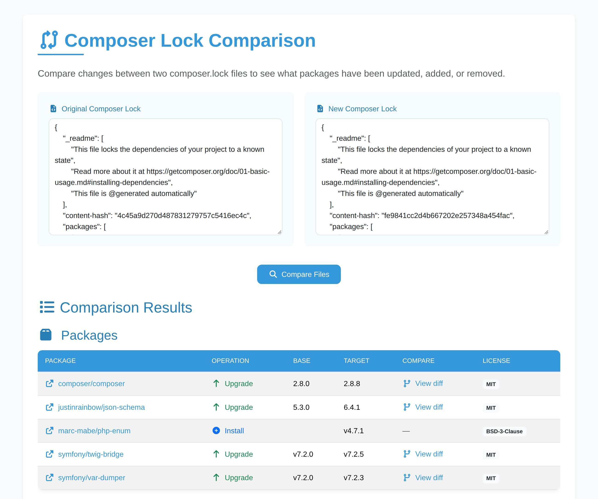

I was upgrading an application, and keeping track of the dependencies was a real mess. The raw diff of a big JSON file is not the best way to see what really changed between two `composer.lock` files.

So I built [Composer Lock Comparison](https://lyrixx.github.io/composer-diff/). You paste two `composer.lock`, and you get a beautiful diff.



## How does it work?

Go to [lyrixx.github.io/composer-diff](https://lyrixx.github.io/composer-diff/). Paste the old file on the left, the new one on the right, and click on "Compare Files". No file at hand? Click on "Load examples".

You get one table for your packages, and another one for your dev packages. For each package, you can see the operation (upgrade, downgrade, install or remove), the versions, the license, and a link to the diff of the package between the two versions.

And there is a Markdown version of the result, so you can paste it in a pull request:

```markdown
| Prod Packages                                             | Operation | Base  | Target |
|-----------------------------------------------------------|-----------|-------|--------|
| [composer/composer](https://github.com/composer/composer) | Upgraded  | 2.8.0 | 2.8.8  |
| [marc-mabe/php-enum](https://github.com/marc-mabe/php-enum) | New     | -     | v4.7.1 |
```

## Where does my composer.lock go?

Nowhere. The website is a static page on GitHub Pages, and there is no server behind it.

Yes, this is PHP. In your browser.

PHP is compiled to WebAssembly and runs in your browser. So your `composer.lock` never leaves the tab, and you can use it with your private packages.

## How is it made?

The code is really small, because the hard work is done by others. The comparison comes from [IonBazan/composer-diff](https://github.com/IonBazan/composer-diff):

```php
$prodOperations = $this->packageDiff->getDiff(
    $this->packageDiff->loadPackagesFromArray($oldLock, false, false),
    $this->packageDiff->loadPackagesFromArray($newLock, false, false)
);
```

And [soyuka/php-wasm](https://github.com/soyuka/php-wasm) showed the way to run PHP in the browser. Thanks to both of them!

## Conclusion

Next time you review a `composer update`, [give it a try](https://lyrixx.github.io/composer-diff/). And the code is [on GitHub](https://github.com/lyrixx/composer-diff).
