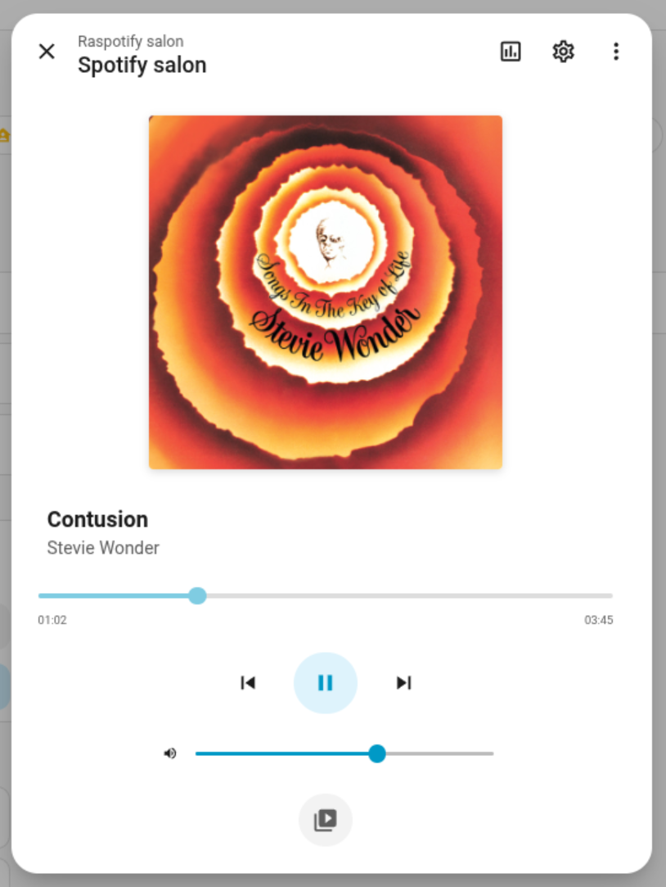

I have a Raspberry Pi 3 in my living room. It runs [raspotify](https://github.com/dtcooper/raspotify), so Spotify sees it as a speaker called "salon". I wanted it in Home Assistant: what is playing, the cover, and a few buttons. Showing what is playing went well. For the buttons, I ended up with three pull requests on [librespot](https://github.com/librespot-org/librespot).

"salon" is the French word for living room.

## Why not the Spotify integration?

Home Assistant has a Spotify integration, but it talks to the servers of Spotify. You need a Premium account and an "app" on their developer portal. And it follows one account: if someone else at home plays music with their own account, Home Assistant doesn't see it.

I wanted to talk to the Pi directly.

## How does Home Assistant know what is playing?

raspotify is a package around librespot, an open source Spotify Connect client. And librespot can run a program on each player event, with `--onevent`. A systemd drop-in plugs my script:

A drop-in is how you extend a systemd unit without touching the file of the package.

```ini {title="/etc/systemd/system/raspotify.service.d/mqtt.conf"}
[Service]
EnvironmentFile=-/etc/raspotify/mqtt.env
Environment=LIBRESPOT_ONEVENT=/usr/local/bin/raspotify-mqtt
Environment=LIBRESPOT_EMIT_SINK_EVENTS=on
ExecStartPost=-/usr/local/bin/raspotify-mqtt start
ExecStopPost=-/usr/local/bin/raspotify-mqtt stop
```

Have you noticed the `-` in front of the paths? If MQTT is down, the script fails, and the music keeps playing.

librespot gives the event to the script in environment variables. The script turns it into MQTT messages:

```python {title="/usr/local/bin/raspotify-mqtt"}
if event == "track_changed":
    track = track_payload(env)
    msgs = [(f"{BASE}/track", json.dumps(track, ensure_ascii=False))]
    if track["cover"]:
        msgs.append((f"{BASE}/cover", track["cover"]))
    return msgs
if event == "volume_changed":
    return [(f"{BASE}/volume", str(round(int(env["VOLUME"]) * 100 / 65535)))]
```

When the service starts, the script also publishes an MQTT discovery message. With it, Home Assistant creates the device by itself: state, title, artist, album, cover and volume.

librespot waits for the script. So for the `sink` event, the script forks: the audio doesn't wait for MQTT.

## But wait

Home Assistant can now watch. But it can't press pause. librespot 0.8 has no local control at all: no HTTP API, no D-Bus, nothing. It only takes its orders from the servers of Spotify.

D-Bus is how programs talk to each other on a Linux machine.

I could have replaced raspotify with [go-librespot](https://github.com/devgianlu/go-librespot), which has a local HTTP API. But there was no rush, so I preferred to fix it upstream.

And someone was already on it. [#1596](https://github.com/librespot-org/librespot/pull/1596), by [@paulfariello](https://github.com/paulfariello), itself based on [#1341](https://github.com/librespot-org/librespot/pull/1341) by [@wisp3rwind](https://github.com/wisp3rwind), adds MPRIS to librespot. MPRIS is the D-Bus interface Linux uses to control a media player: when the play/pause key of your keyboard pauses the music, on a Linux desktop, it goes through MPRIS. The PR had been waiting for a final review since June.

Unfortunately, it could not work on my Pi. D-Bus has two kinds of buses: a session bus for each logged-in user, and one system bus for the whole machine. And:

- The PR registers on the session bus, but raspotify is a system service, without any session
- When it can't reach the bus, librespot exits

So I took it over, in [#1778](https://github.com/librespot-org/librespot/pull/1778). I kept the original commits, addressed the review comments, and fixed a few bugs. For example, a stray space in an object path made the metadata disappear when there was no track. And a failed MPRIS init is now a warning.

Then [#1779](https://github.com/librespot-org/librespot/pull/1779) adds one option: `--mpris-bus system`.

## How to use the system bus?

Another drop-in replaces the librespot of the package with my build:

```ini {title="/etc/systemd/system/raspotify.service.d/mpris.conf"}
[Service]
ExecStart=
ExecStart=/usr/local/bin/librespot-mpris
Environment=LIBRESPOT_MPRIS_BUS=system
```

I cross-compile it on my laptop: the Pi 3 doesn't have enough RAM to build librespot.

But on the system bus, nobody can take a name without a policy, not even root. So D-Bus needs one more file:

```xml {title="/etc/dbus-1/system.d/librespot-mpris.conf"}
<!DOCTYPE busconfig PUBLIC "-//freedesktop//DTD D-BUS Bus Configuration 1.0//EN"
 "http://www.freedesktop.org/standards/dbus/1.0/busconfig.dtd">
<busconfig>
  <policy user="root">
    <allow own_prefix="org.mpris.MediaPlayer2.librespot"/>
    <allow send_destination="org.mpris.MediaPlayer2.librespot"/>
  </policy>
</busconfig>
```

Note: don't write `--mpris-bus` in a comment of this file. A `--` in an XML comment is invalid, and dbus-daemon rejects the whole file. Yes, I did it.

## Who presses the button?

Home Assistant speaks MQTT, and librespot now speaks MPRIS. So a second script runs on the Pi, as a service. It listens to MQTT, and calls MPRIS. Here is a simplified version:

```python {title="/usr/local/bin/raspotify-controls"}
METHODS = {"play_pause": "PlayPause", "play": "Play", "pause": "Pause", "next": "Next", "previous": "Previous"}


def player():
    # Connect for each command: survives librespot and D-Bus restarts
    return dbus.SystemBus().get_object(BUS_NAME, OBJECT_PATH)


def handle(command, payload):
    if command in METHODS:
        player().get_dbus_method(METHODS[command], PLAYER)()
```

The MQTT integration of Home Assistant has buttons and sliders, but no media player. So the script also publishes everything in the format of [mqtt_media_player](https://github.com/bkbilly/mqtt_media_player), a custom integration. This one gives a real `media_player` entity, with the native card:



Here is the whole loop:


There is a limit. The buttons only work while a phone has a session on "salon". My raspotify doesn't keep any credentials, so without a phone, MPRIS answers "Not connected".

## And then the music stopped

A month later, I had another problem: from time to time, the music stopped, and my phone lost "salon".

Spotify closes the connection of the Pi about once a day: 34 times in October. And librespot 0.8 doesn't notice. It finds out at the next event: the end of the track, a command from the phone… On November 3rd, the connection dropped at 11:54, and librespot noticed at 2:23 the next night. Then it starts again from a blank state.

The Pi is on Ethernet, and the local network was fine every time.

Again, someone was already on it. [@antoinecellerier](https://github.com/antoinecellerier) had diagnosed these failures on real devices for months, in [#1692](https://github.com/librespot-org/librespot/pull/1692), and fixed them one by one. But the PR was a draft, and no maintainer had answered. I reviewed it, I offered to finish it, and Antoine said yes.

The result is [#1861](https://github.com/librespot-org/librespot/pull/1861). The hard part is Antoine's work. On top of it, librespot now notices a lost session right away, keeps trying while the network is down, and keeps the playback state when a recovery fails.

[@szymon188](https://github.com/szymon188) ran both builds on the same Raspberry Pi 4, and [posted the numbers](https://github.com/librespot-org/librespot/pull/1861#issuecomment-6830388810):

- Before, about 1 track in 4 was skipped. After, 2 in 1,019
- Before, a watchdog restarted raspotify about 155 times a day. After, 3 times in 7 days

At home, it's too soon to tell. In 8 days, librespot recovered from 16 drops without any error. But nothing was playing during any of them. I have not seen a track survive a drop yet.

## Conclusion

None of the three PRs is merged yet. So my Pi runs [my own branch](https://github.com/lyrixx/librespot/tree/raspotify-salon), with all of them. Once they are merged, and once raspotify ships MPRIS and the D-Bus policy, I will delete my drop-in and go back to the package.

Until then, my living room runs on a fork 😅
