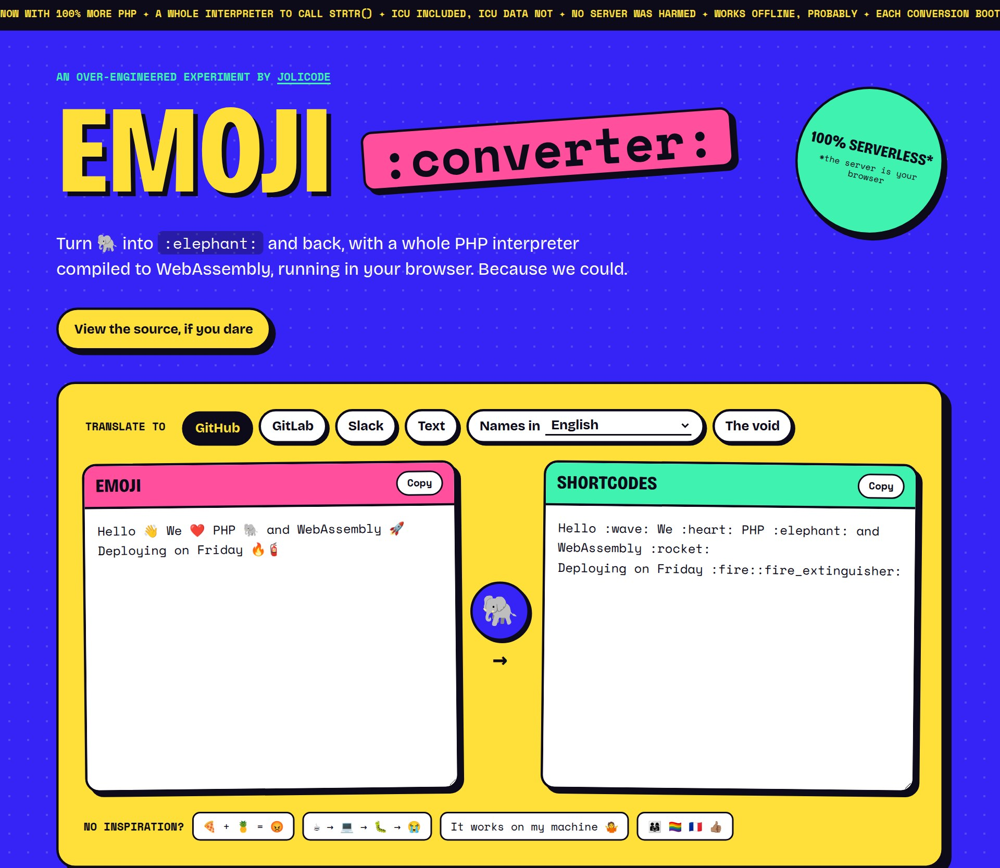
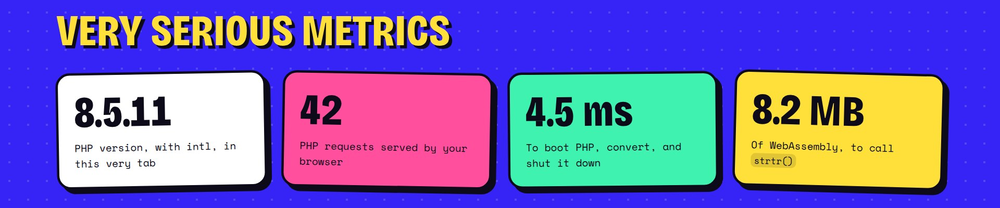

I maintain symfony/emoji, and I thought it would be hilarious to build something with it in WebAssembly. So here is [Emoji Converter](https://jolicode.github.io/emoji-converter/). It turns 🐘 into `:elephant:` and back, with a whole PHP interpreter running in your browser.



## Is it a joke?

Mostly 😁. symfony/emoji converts your text with a good old `strtr()`, and I ship 8 MB of WebAssembly to call it.

A whole interpreter to call strtr().

But it works. And it's fast: a few milliseconds per conversion, PHP boot included.



## What does it do?

It converts emoji to shortcodes (GitHub, GitLab, Slack, text), to their names in 136 languages, or to nothing at all. And it converts them back. There is no server, so your text never leaves the tab.

100% serverless: the server is your browser.

The PHP part is a thin layer over symfony/emoji:

```php
$converter = new EmojiConverter();

$converter->fromEmoji('github', 'Hello 👋 🐘'); // Hello :wave: :elephant:
$converter->fromEmoji('fr', 'Hello 👋 🐘'); // Hello signe de la main éléphant
$converter->toEmoji('slack', 'Hello :wave: :elephant:'); // Hello 👋 🐘
```

But symfony/emoji only converts shortcodes back to emoji. Names are ordinary words, so a simple `strtr()` would also replace them inside other words. In French, "chat" (cat) is also in "achat" (purchase).

So the converter replaces whole words only, and it prefers the longest name:

```php
$converter->toEmoji('fr', 'Un chat noir, pas un achat'); // Un 🐈‍⬛, pas un achat
```

## How does it work?

PHP 8.5 is compiled with Emscripten by [php-wasm-builder](https://github.com/lyrixx/php-wasm-builder), and the application is embedded in the build.

For each conversion, the page runs a small PHP script. The request goes on stdin, and the result comes back on stdout, as JSON:

```php
$request = json_decode(file_get_contents('php://stdin'), true, flags: \JSON_THROW_ON_ERROR);

$converter = new EmojiConverter();

// ...

echo json_encode($result, \JSON_THROW_ON_ERROR);
```

PHP is started and shut down on each conversion. Yes, like CGI.

## What was the hard part?

Not the emoji. The hard part was the intl extension, because symfony/emoji needs the `\Transliterator` class.

You can't just load an `intl.so`: `dlopen()` compiles WebAssembly synchronously, and Chrome refuses that on the main thread. So ICU is statically linked in the binary.

Then there is the size. The ICU data weighs about 30 MB, and the catalogs of symfony/emoji about 37 MB. So I don't ship the ICU data at all: everything else that needs it (`Collator`, `NumberFormatter`…) fails. And the page only fetches the catalogs it needs.

The 30 MB of ICU data stayed home.

Note: Fibers and `proc_open()` don't work either. Emscripten does not provide the functions they rely on.

## Conclusion

Is it useful? Not really. But I had fun, and it was a good excuse to build PHP with intl for the browser. [Try it](https://jolicode.github.io/emoji-converter/), and the code is [on GitHub](https://github.com/jolicode/emoji-converter).
