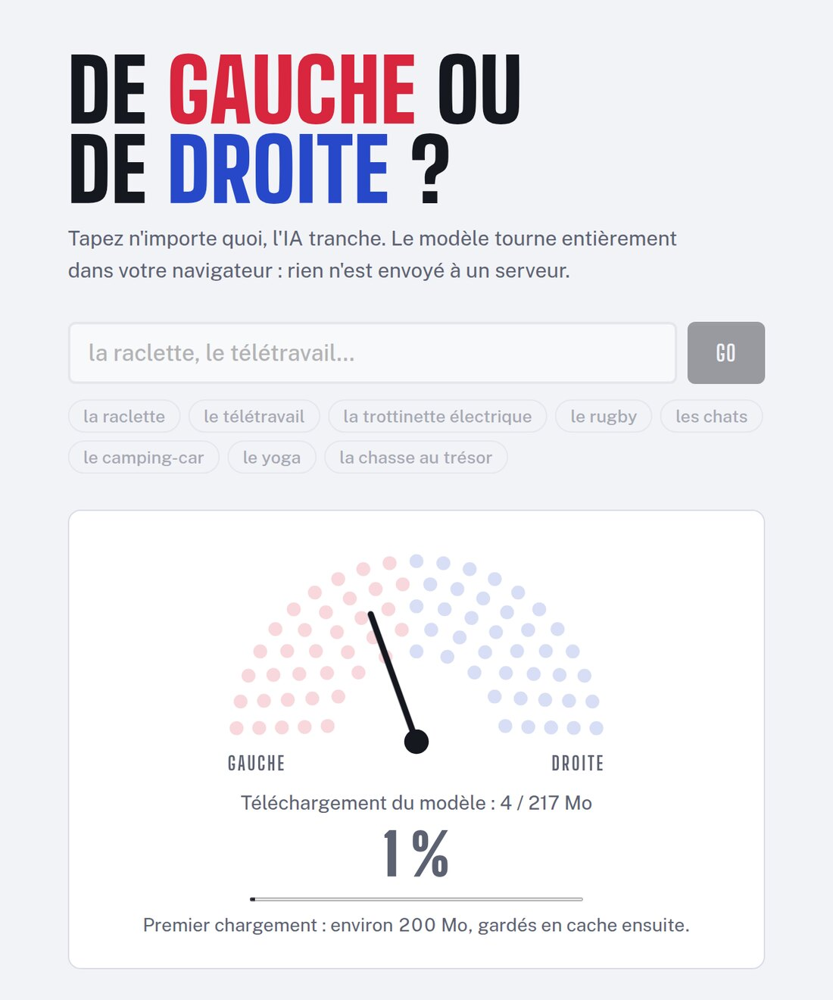
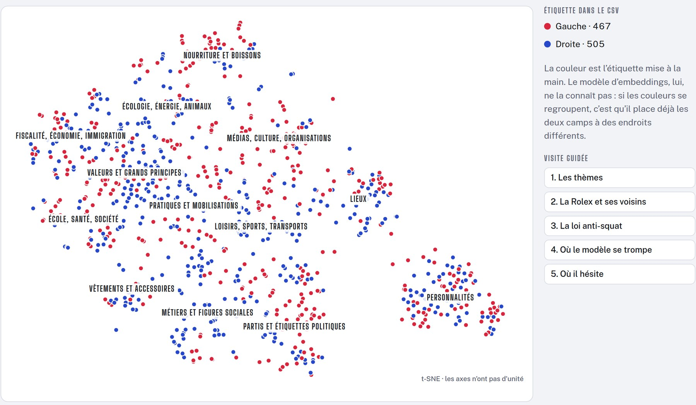

Vous tapez n'importe quoi (« la raclette », « le vélo », « Chateaubriand »), et une IA vous dit si c'est de gauche ou de droite. C'est [De gauche ou de droite ?](https://lyrixx.github.io/gauche-ou-droite/), un clone du [site de Théo Delemazure](https://degaucheoudedroite.delemazure.fr/), avec une différence : le modèle tourne entièrement dans votre navigateur. Il n'y a ni serveur ni API.

L'IA a été entraînée sur des clichés, donc à ne pas prendre au sérieux.



## Comment c'est parti ?

Je voulais tester Jev, un nouveau modèle de TypeSafe AI, dans une page statique. Jev ne génère pas de texte : il renvoie une décision et un score de confiance. Exactement ce qu'il me fallait.

Mais Jev est propriétaire, et accessible seulement par API. Impossible de le faire tourner dans un navigateur.

Pas de poids ouverts, pas de chocolat.

J'ai donc gardé l'idée et la page statique, et j'ai remplacé Jev par un classifieur fait maison.

## Pourquoi pas un petit LLM ?

La première idée, c'est un petit LLM open source dans le navigateur. Mais c'est un giga ou plus à télécharger, il est médiocre en français à cette taille, et surtout, un LLM, ça discute. On lui demande « gauche ou droite ? », il répond « alors, c'est une question complexe… ». Moi, je voulais un modèle qui décide.

Un modèle d'embeddings fait un seul passage sur la phrase, là où un LLM génère sa réponse mot par mot :

```
"le vélo" ──► modèle d'embeddings ──► vecteur ──► régression logistique ──► 72 % gauche
```

Le modèle d'embeddings ne sait rien de la politique, il représente seulement le sens d'un texte. Ensuite, une régression logistique, entraînée sur 972 exemples étiquetés, trouve quelle direction veut dire gauche, et laquelle veut dire droite.

## Est-ce que plus d'exemples, ça aide ?

Pas vraiment. Je suis passé de 253 exemples à 952, et la précision n'est passée que de 66-68 % à 68,7 %. J'ai tout mesuré avec une validation croisée : on cache 1/5 des exemples, on entraîne sur le reste, et on mesure sur la partie cachée.

Les nouveaux exemples ont quand même corrigé des cas gênants. Avant, « facho » était de gauche à 84 %.

Et « Marine Le Pen » à 86 %.

Le vrai goulot d'étranglement, c'était le modèle. J'ai donc monté un banc d'essai avec 11 modèles d'embeddings. EmbeddingGemma (197 Mo) atteint 81-82 %, contre 70,6 % pour la première version avec multilingual-e5-small. Dans le vrai pipeline, il donne 79 %.

Le résultat le plus drôle vient de Qwen3-Embedding. Son vecteur est calculé à partir du dernier mot de la phrase. Si le texte se termine par « votent pour », la précision passe donc de 80 % à 89 %. Du prompt engineering, pour un embedding ! Mais il pèse 614 Mo.

Et le zero-shot, qui compare le texte à « de gauche » et « de droite » sans aucun entraînement, donne 48 à 60 %. Pas mieux que le hasard. Il faut dire que « de droite », c'est aussi… le côté droit.

## Quel classifieur choisir ?

Une fois le modèle d'embeddings choisi, il reste à décider qui tranche. J'ai donc monté [un second banc d'essai](https://lyrixx.github.io/gauche-ou-droite/media/bench/) : 12 classifieurs entraînés sur les embeddings des 972 exemples, avec les mêmes découpages pour tous.

Le SVM à noyau RBF arrive en tête avec 81,8 %, contre 78,8 % pour la régression logistique du site. Aucun autre ne gagne 3 points.

Les modèles à arbres ne battent pas un modèle linéaire : Random Forest, XGBoost, CatBoost et LightGBM restent entre 77,6 % et 79,4 %. Dans un embedding, l'information est répartie sur des centaines de dimensions à la fois, alors qu'un arbre découpe une variable à la fois.

Réduire la dimension n'apporte rien non plus. La précision augmente avec le nombre de composantes gardées, et rejoint celle des 768 dimensions vers 512.

Le gain le moins cher vient de la régularisation. La régression du site apprend ses exemples par cœur : 99,9 % sur ceux qu'elle a vus, 78,8 % sur les autres. Avec une régularisation environ 40 fois plus forte (λ ≈ 0,4 au lieu de 0,01), elle passe à 80,0 %.

Mais attention à ne pas trop lire dans ces chiffres. Avec 972 exemples, la marge d'erreur sur une précision de 80 % est d'environ ±2,5 points. Un écart d'un point entre deux modèles ne veut donc rien dire.

Et le site ? Il garde sa régression logistique, avec λ = 0,01. Pourquoi ? Flemme de changer 😅.

## Qu'est-ce qui a cassé dans le navigateur ?

La version q4 standard du modèle fonctionne dans Node, mais pas dans le navigateur. Elle utilise une opération (`GatherBlockQuantized`) que le moteur WebAssembly d'onnxruntime ne sait pas exécuter. L'entraînement et le site utilisent donc la variante `model_no_gather_q4`, pour obtenir les mêmes vecteurs des deux côtés.

Ensuite, la page gelait. Avec EmbeddingGemma, un calcul prend environ 1 seconde dans le navigateur, parce que GitHub Pages ne peut pas envoyer les en-têtes COOP/COEP qui autorisent plusieurs cœurs. Une option déplace ce calcul dans un Web Worker :

```js
env.backends.onnx.wasm.proxy = true;
```

Et envoyer le formulaire pendant le téléchargement rechargeait la page, ce qui relançait les 200 Mo 😅. Le formulaire est donc verrouillé tant que le modèle n'est pas prêt.

## Qu'a appris le modèle ?

Le [nuage des exemples](https://lyrixx.github.io/gauche-ou-droite/media/nuage/) permet de le voir. Chaque point est un des 972 exemples : EmbeddingGemma le transforme en vecteur de 768 nombres, puis t-SNE ramène ces vecteurs sur un plan, en gardant ensemble les textes de sens proche.

La question est la suivante : avant même qu'on lui apprenne quoi que ce soit, le modèle range-t-il la gauche d'un côté et la droite de l'autre ?



Pas vraiment. La carte est rangée par thème, pas par camp. Les personnalités sont ensemble, les lieux ensemble, la nourriture ensemble, et on trouve les deux couleurs dans chaque thème. Le modèle a d'abord appris de quoi parle un texte. Le camp n'arrive qu'en second.

Mais dans un thème, le camp se voit parfois très bien. Les 8 plus proches voisins de « la Rolex » sont tous étiquetés à droite : montre suisse, Porsche, sac Louis Vuitton… Ceux des « vêtements de seconde main » sont surtout à gauche : friperie, Vinted, tote bag. Sur les modes de vie, les clichés sont déjà dans les vecteurs.

Ça coince sur les prises de position. Le modèle se trompe sur 30 % des exemples de fiscalité et d'immigration, contre 10 % pour les partis et les étiquettes. Un embedding dit de quoi on parle, pas si on est pour ou contre : le plus proche voisin de « la loi anti-squat », c'est « le squat ».

Pour un embedding, c'est pareil.

C'est aussi pour ça que le nuage paraît mélangé, malgré 79 % de bonnes réponses. Parmi les 10 plus proches voisins d'un exemple, seuls 65 % ont la même étiquette. La régression, elle, cherche une seule direction « gauche → droite » qui traverse tous les thèmes. C'est elle qui fait la différence.

## Conclusion

[Essayez-le](https://lyrixx.github.io/gauche-ou-droite/). La première visite télécharge environ 200 Mo, ensuite le modèle reste en cache. Tout est expliqué dans [le README](https://github.com/lyrixx/gauche-ou-droite) et dans [les slides de mon lightning talk](https://lyrixx.github.io/gauche-ou-droite/media/slides/).
