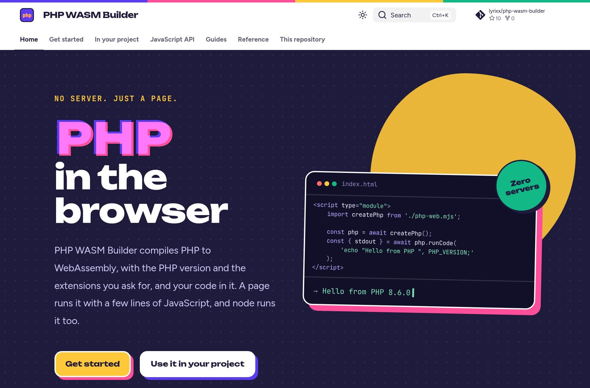
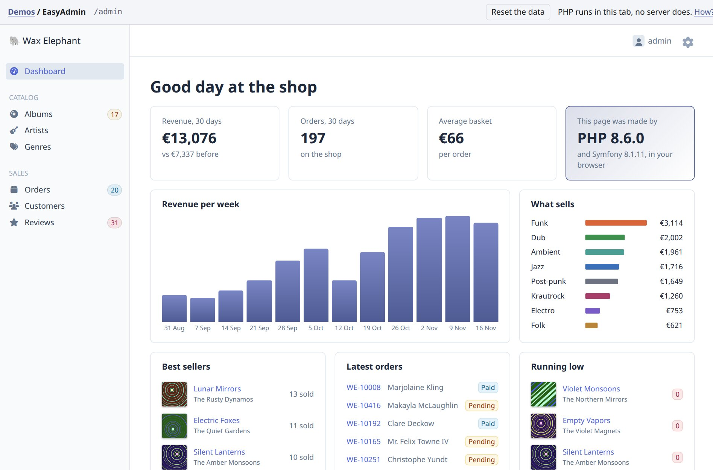
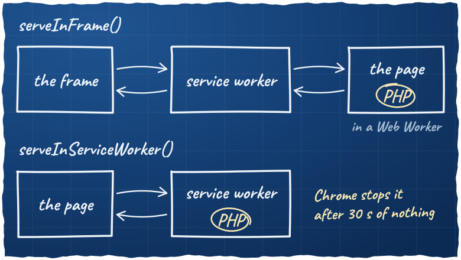

php-wasm-builder 1.0 is out. It compiles PHP to WebAssembly, with the PHP version and the extensions you pick, and your code inside. Then a page runs it, with no PHP server. node runs it too.



I already wrote about two tools that use it, [composer-diff](/posts/how-to-compare-two-composer-lock-files/) and [Emoji Converter](/posts/how-to-convert-emoji-with-php-in-your-browser/). But I never wrote about the builder itself, so let's start from the beginning.

## What can it do?

Here is a page that runs PHP:

```html
<script type="module">
    import createPhp from './build/php-web.mjs';

    const php = await createPhp();
    const { stdout } = await php.runCode('echo "Hello from PHP ", PHP_VERSION;');
</script>
```

It prints `Hello from PHP 8.6.0`. PHP 8.3, 8.4 and 8.5 work too.

Printing the version is not very useful. But you can reuse PHP code that already exists, without porting it to JavaScript. [JoliTypo](https://jolitypo.jolicode.com/) fixes the microtypography of a text, [JoliMarkdown](https://jolimarkdown.jolicode.com/) fixes Markdown, and [structured-data](https://structured-data-validator.jolicode.com/) validates the schema.org data of a page. All three are PHP libraries, and all three run in your browser.

And it goes further: whole Symfony applications run too. The [Symfony Demo](https://lyrixx.github.io/php-wasm-demo/symfony-demo/) runs as it is, with its admin, Doctrine, SQLite and 30 languages. And [an EasyAdmin back office](https://lyrixx.github.io/php-wasm-demo/easyadmin/) runs for a record shop that never existed.

Yes, the whole Symfony Demo. In your browser.



There is no server behind them, only static files on GitHub Pages. So there is no server to pay for or to patch. And your data never leaves the tab.

## How does it work?

WebAssembly is an instruction set for a CPU that does not exist. You compile once for this CPU, and the browser translates it to the real one when it loads the file. The module lives in a sandbox, without files or network. It can only call the functions that JavaScript gives it.

PHP is a big C program, and C compiles to WebAssembly with [Emscripten](https://emscripten.org/). Its compiler replaces gcc, and its JavaScript glue plays the role of the kernel. When PHP writes on stdout, the glue gets the bytes. When PHP opens a file, the glue reads it from a filesystem in memory. It's a fake OS, written in JavaScript.

A CPU that does not exist, and an OS written in JavaScript.

But PHP needs a way in. PHP talks to the outside world through a SAPI, its Server API: `cli` when you run `php` in your terminal, `fpm` behind nginx. A lesser known one, `embed`, turns PHP into a library that your own C program calls. Here, this program is `run.c`. It starts PHP, runs your code, and stops it. So each run is a whole request, and nothing is left behind. Shared nothing, like on a server.

That's PHP alone. But you also want extensions, like mbstring, dom or intl, and many of them rely on a C library: oniguruma for mbstring, libxml2 for dom, ICU for intl. These libraries must be compiled to WebAssembly too. And there is no `.so` to load: everything is linked in a single `.wasm` file.

So here is what your page loads:


To compile all of this, you need the right version of Emscripten, and to know how to cross-compile each library. php-wasm-builder keeps all of it in a Dockerfile, so you only need Docker. It has a stage for each library, and a first stage that turns the extensions you ask for into a plan. With mbstring and dom, only oniguruma and libxml2 are compiled. Add intl, and only ICU is compiled, then PHP. Everything else comes from the Docker cache.

That's the short version. **The slides of my talk, [PHP in the browser](https://lyrixx.github.io/php-in-the-browser/)**, go much deeper, from the bytes of a `.wasm` file to Symfony. And they run PHP, in the page. I really like them.

## How do I use it in my project?

With [castor](https://castor.jolicode.com/), you install the package:

```bash
castor composer require lyrixx/php-wasm-builder
```

Then you declare a stack in your `castor.php`:

```php {title="castor.php"}
use PhpWasm\Stack;
use PhpWasm\Target;

function wasm_stack(): Stack
{
    return Stack::named('app')
        ->php('8.6.0')
        ->extensions('ctype', 'mbstring')
        ->embed('build/embed', at: '/app')
        ->targets(Target::Web)
        ->outputDir('public/build');
}
```

PHP does not see your disk: `embed()` puts a directory inside the `.wasm` file, at `/app`. Preparing this directory is up to you. So you write a task that copies your code there, installs its `vendor/` without the dev dependencies, and builds PHP:

```php {title="castor.php"}
use Castor\Attribute\AsTask;

use function Castor\context;
use function Castor\fs;
use function Castor\run;
use function PhpWasm\build;

#[AsTask('build', namespace: 'wasm')]
function wasm_build(): void
{
    $embed = __DIR__ . '/build/embed';
    fs()->remove($embed);
    fs()->mirror(__DIR__ . '/src', "{$embed}/src");
    fs()->copy(__DIR__ . '/composer.json', "{$embed}/composer.json");
    fs()->copy(__DIR__ . '/composer.lock', "{$embed}/composer.lock");
    run(['composer', 'install', '--no-dev', '--classmap-authoritative'], context: context()->withWorkingDirectory($embed));

    build([wasm_stack()]);
}
```

`castor wasm:build` writes `php-web.mjs` and `php-web.wasm` in `public/build/`. Then the page runs your code:

```js
const { exitCode, stdout } = await php.runFile('/app/src/page.php', { stdin: 'Hello...' });
```

The input goes on stdin, the result comes back on stdout. And what PHP writes is lost when you reload the page, unless you ask for a directory to be kept. The builder then saves it in IndexedDB, a database that your browser keeps for each website. The Symfony example keeps its SQLite database there.

No castor in your project? Composer and Docker work too. The [documentation](https://lyrixx.github.io/php-wasm-builder/your-project/) shows both, with the tests in node and the deployment to GitHub Pages.

Now the price: the size. PHP 8.6 with the default extensions is 8.7 MB, 3.1 MB once gzipped. The Symfony example, with its `vendor/`, is 7.2 MB gzipped. And intl is the heavy one: ICU ships the data of every language, and the build goes up to 16.4 MB gzipped.

## And Symfony?

Symfony wants an HTTP request, not a script. So `php.request()` runs PHP as a web server does, and gives back the status, the headers and the body.

But a browser asks for more than one page: links, forms, redirections, stylesheets. And GitHub Pages has none of these files. The only place that sees all the requests of a page is a service worker, a script that the browser puts between the page and the network. So it answers them, with what PHP answers.

There are two ways to do it, one function each:



`serveInFrame()` shows the application in an `<iframe>`. The service worker hands each request to the page, and PHP runs in a Web Worker, a thread that the page starts next to its own. So the page does not freeze while PHP works.

`serveInServiceWorker()` puts the application on its own page, and PHP runs in the service worker itself. It feels like a real website, with the address bar and the history. But Chrome stops a service worker after 30 seconds of nothing, and PHP with it. The next request starts it again, and the database is still in IndexedDB.

The browser also hides the cookies and the `Referer` from a service worker. The builder gives them back to PHP.

It did not work the first time. Symfony crashed while compiling its container, with objects calling a null function. What the hell? The C stack of Emscripten is 64 KB by default. 400 callbacks deep, PHP wrote over its own memory, without any error. The stack is 1 MB now, and checked.

Then the example died after about 1,900 requests. PHP was using the `malloc()` of the libc, and it counts on its own allocator to throw everything away at the end of a request. So `run.c` now gives Zend MM its memory itself, and `memory_limit` works, as a bonus.

And it was slow, as Symfony compiled its container at each visit. The build can now run a warmup, `bin/console cache:warmup` here, with PHP running in node during the Docker build. And opcache keeps its opcodes in files instead of shared memory, which does not exist here. In the end, in node, the requests of the example go from 115 ms to 35 ms.

On the way, I hit three bugs in PHP. Two of them are fixed in PHP 8.5.13. For the third one, I wrote [the issue](https://github.com/php/php-src/issues/25195) with a one-line fix, and offered to open the pull request. Someone else opened it with my patch, without crediting me 😕. At least, the changelog of PHP credits me now.

## What does not work?

The module is 32 bits. `PHP_INT_MAX` is 2,147,483,647, and timestamps stop in 2038.

See you on 2038-01-19.

There is no network. No curl, and Symfony HttpClient or Guzzle fail. What PHP needs from the network comes from JavaScript: `fetch()` it first, and give it to PHP on stdin.

There are no processes either: `proc_open()`, `exec()` and Symfony Process fail with a warning. And a Fiber kills the module, because WebAssembly can not pause and resume a stack.

## What does 1.0 change?

0.1.0 was released on 2026-10-20, and 0.14.0 on 2026-11-20. That's 14 minor versions in a month, and half of them broke something.

1.0.0 is a promise: from now on, it follows Semantic Versioning. The build arguments, the default extensions, the files that are built, the JavaScript API and `Stack` don't break in a minor version. The versions of PHP, Emscripten and the libraries still move, and the sizes too. The [backward compatibility page](https://lyrixx.github.io/php-wasm-builder/reference/backward-compatibility/) lists it all.

Before making this promise, I went through the whole library once more, to break now what would have been stuck afterwards. `php.request()` behaves like a web server in production: a fatal error is a 500, and the errors go to the console instead of the page. It runs the `index.php` of a directory, and fills `PATH_INFO`. The Dockerfile checks what it downloads. And the examples run in a real Chrome in the CI, with their service workers and IndexedDB, which node does not have.

## Why a fork?

[Derick Rethans](https://github.com/derickr) created [this builder](https://github.com/derickr/php-wasm-builder) for The PHP Foundation, to build the WebAssembly files of the php.net documentation, where the examples run in the page.

In September, I [proposed](https://github.com/derickr/php-wasm-builder/issues/11) to make it build any PHP version, with any extensions, in one command. It didn't get much of an answer. But I use WebAssembly a lot, and I needed a builder that fits my needs, and that moves fast. So in October, I carried on in my fork.

Thanks to Derick, then. Thanks to [Antoine Bluchet](https://github.com/soyuka), alias soyuka, too: `run.c` comes from his work on PHP in WebAssembly, in [soyuka/php-wasm](https://github.com/soyuka/php-wasm). And thanks to Lewis Cowles, Arnaud Le Blanc, Jordi Kroon and Marc (henderkes), for their work on the original repository, intl included.

The [documentation](https://lyrixx.github.io/php-wasm-builder/) has everything else, and its examples run in your browser. The code is [on GitHub](https://github.com/lyrixx/php-wasm-builder).
