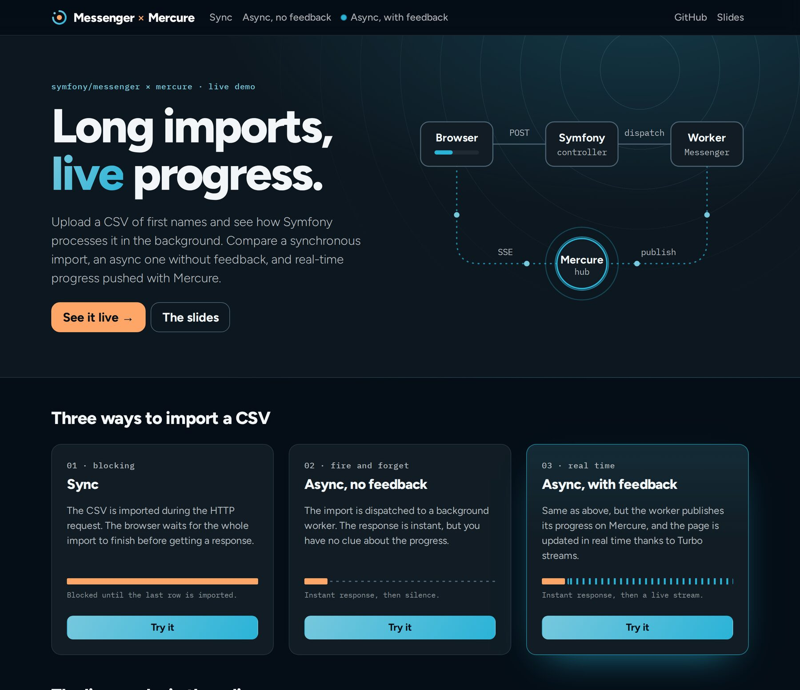
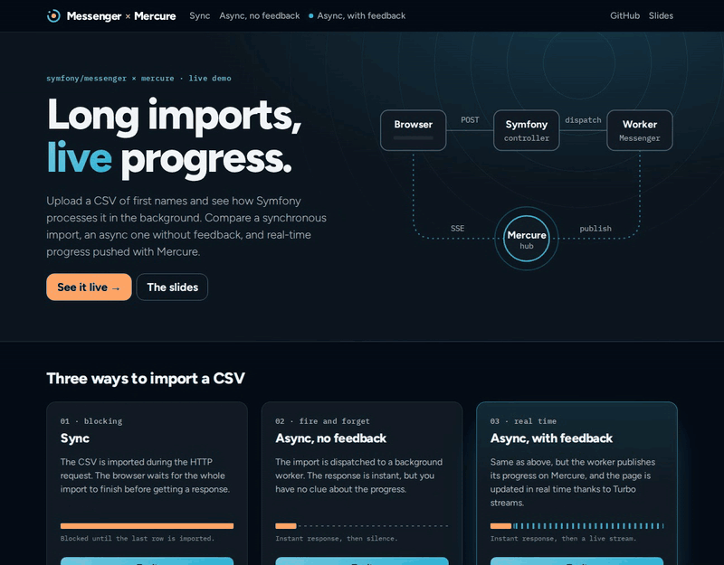

For SymfonyLive Paris 2025, I gave [a talk about async with Messenger and Mercure](https://speakerdeck.com/lyrixx/asynchrone-avec-symfony-messenger-et-mercure), and I built [a demo](https://github.com/lyrixx/async-messenger-mercure) for it. A year and a half later, this demo got a big update: Symfony 8.1, FrankenPHP and Mercure 1.0.

Why now? I was fed up with the ugly UI, the demo was getting old, and Mercure 1.0 had just come out.



## What does the demo do?

You upload a CSV of first names, and you compare three ways to import it:

- Sync: the import runs during the HTTP request, and the browser waits
- Async, no feedback: a worker does the job, the response is instant, but you have no clue about the progress
- Async, with feedback: same thing, but the worker publishes its progress on Mercure, and the page is updated in real time



No polling involved. The worker renders a Twig block, and it publishes the result:

```php
$content = $this->twig->load('csv/async.html.twig')->renderBlock('status', [
    // ...
]);

$this->mercurePublisher->publish(new Update("csv:{$importId}", $content));
```

And the page subscribes to it with one line:

```twig
{{ turbo_stream_from('csv:' ~ importId) }}
```

This is new too. `turbo_stream_listen()` is deprecated since UX Turbo 3.1, so I moved to `turbo_stream_from()`.

Note: a Messenger worker keeps the code it started with. So restart it after a `composer install`, or your imports will fail with `Unknown "turbo_stream_from" function`.

## What changed?

The demo now has a home page, with the three modes, and it runs on Symfony 8.1. The Docker stack comes from docker-starter, with FrankenPHP, which embeds the Mercure hub.

It also got a PHPUnit test suite and a CI. And I fixed two bugs along the way: submitting the form without a file was a 500 error, and a service was named `deabug.log_processor`.

Yes, deabug.

Cherry on top: `castor media` drives a real headless Chromium, with [Playwright PHP](https://github.com/playwright-php/playwright), to regenerate the screenshot and the GIF of this article.

## What about Mercure 1.0?

FrankenPHP 1.13 embeds the Mercure 1.0 hub, and mercure-bundle 0.6 speaks protocol 1.0 by default. So both sides must move together.

The main change is about the JWT tokens: the hub now only trusts the tokens of a known issuer. So the `Caddyfile`, which configures the hub, looks like this:

```caddyfile
issuer {$MERCURE_JWT_ISSUER} {
    publisher {
        jwt {env.MERCURE_PUBLISHER_JWT_KEY} {env.MERCURE_PUBLISHER_JWT_ALG}
    }
    subscriber {
        jwt {env.MERCURE_SUBSCRIBER_JWT_KEY} {env.MERCURE_SUBSCRIBER_JWT_ALG}
    }
}
```

These are environment variables, set in the `docker-compose.yml` of the demo:

- `MERCURE_JWT_ISSUER` is a name you choose for the issuer of your tokens. The demo uses its own URL, `https://async-messenger-mercure.test`
- `MERCURE_PUBLISHER_JWT_KEY` and `MERCURE_SUBSCRIBER_JWT_KEY` are the secrets used to sign the tokens. Use your own secrets, not the ones of the demo
- `MERCURE_PUBLISHER_JWT_ALG` and `MERCURE_SUBSCRIBER_JWT_ALG` are the signing algorithms. The demo doesn't set them, so the hub uses its default, `HS256`

Symfony signs the tokens, so it needs the same issuer, in the `iss` claim:

```yaml
mercure:
    hubs:
        default:
            jwt:
                claims:
                    iss: '%env(MERCURE_JWT_ISSUER)%'
```

But wait, there is a trap. The `demo` and `ui` options of the `Caddyfile`, which enabled the debug interface of the hub, are gone. So I replaced them with `playground`.

The problem is that FrankenPHP serves the hub and the application on the same site. And the playground redirects `/` to the debug interface. So when I opened the demo, I no longer saw the home page of the application, but the debug interface of Mercure 😅.

The fix is to use `debugger` instead. It serves the debug interface at `/.well-known/mercure/debug/`, and it leaves `/` to the application.

## Conclusion

The demo runs on your machine, you only need Docker and Castor:

```bash
castor start
```

The code is [on GitHub](https://github.com/lyrixx/async-messenger-mercure), and the slides are [on Speaker Deck](https://speakerdeck.com/lyrixx/asynchrone-avec-symfony-messenger-et-mercure).
