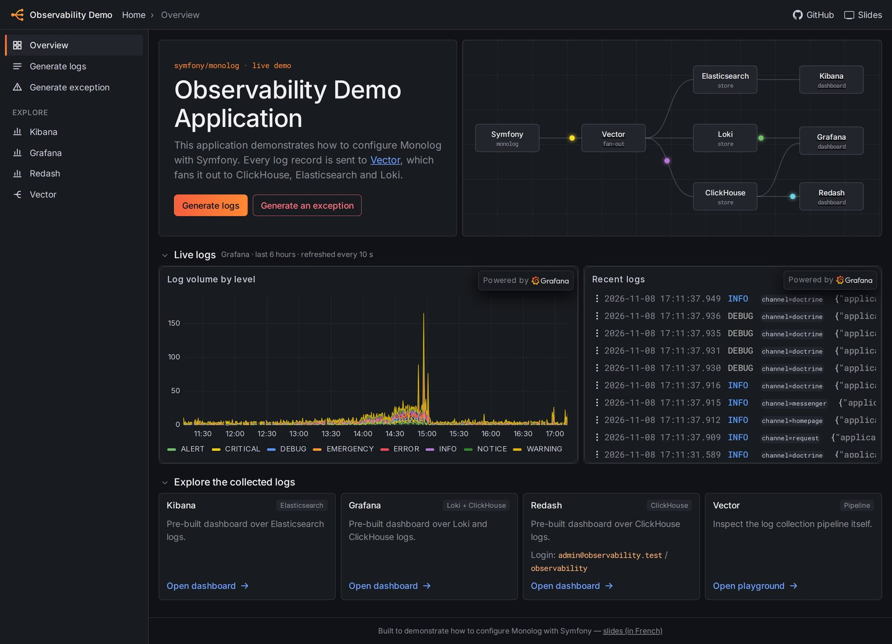
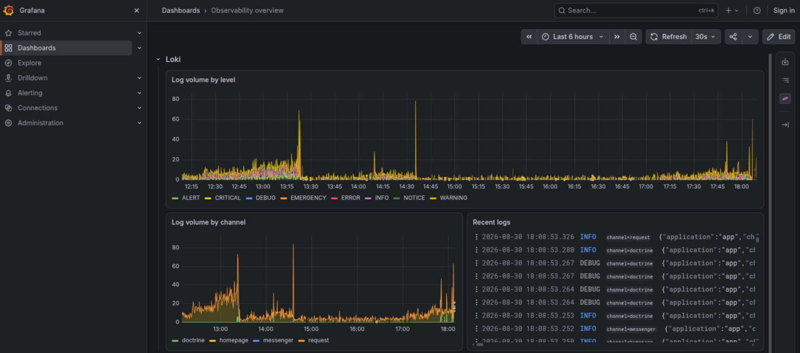
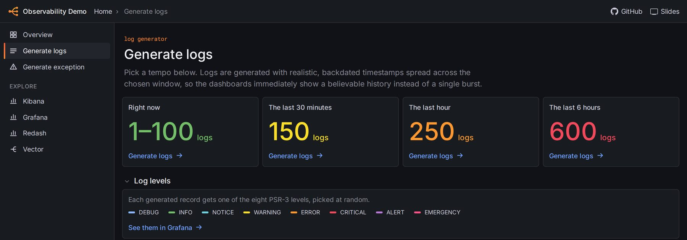

I just wanted to give my [observability demo](https://github.com/lyrixx/symfony-observability-demo) a little refresh. It ended up with 95 files changed, 8,432 new lines, and Symfony going from 7.0 to 8.1 😅.



## What is this demo?

It's a small Symfony application I built for [a talk about logs](https://s.lyrixx.info/log) (in French). It shows how to configure Monolog, and what a real observability stack looks like around it.

Every log record goes to [Vector](https://vector.dev/), which fans it out to ClickHouse, Elasticsearch and Loki. And each one comes with its own tool: Redash, Kibana and Grafana.

The Monolog part is really short:

```yaml
monolog:
    handlers:
        syslog:
            type: syslogudp
            host: vector
            port: 9000
            formatter: monolog.formatter.json
            channels: ["!event"]
```

## What changed?

The application now runs on Symfony 8.1, and the Docker stack comes from docker-starter. It got a Bootstrap frontend with AssetMapper, so no Node, and a dark theme inspired by Grafana. It also got tests and a CI.

And `castor start` now provisions a dashboard in Kibana, Grafana and Redash. So the links of the homepage show real data, instead of an empty tool. The homepage also embeds two panels of the Grafana dashboard: the volume of logs by level, and the recent logs.



## How to fill a dashboard?

A dashboard needs data. But if you generate 600 logs with one click, they all land at the same time, and you get a single spike. Not very realistic.

So the "Generate logs" button now asks for a tempo: right now, the last 30 minutes, the last hour, or the last 6 hours.



And the logs are backdated, with a small Monolog processor:

```php
public function __invoke(LogRecord $record): LogRecord
{
    $backdateTo = $record->context['backdate_to'] ?? null;

    if (!$backdateTo instanceof \DateTimeImmutable) {
        return $record;
    }

    $context = $record->context;
    unset($context['backdate_to']);

    return $record->with(datetime: $backdateTo, context: $context);
}
```

But wait. Vector has to use the date of the record, instead of the time it received it:

```yaml
.timestamp = parse_timestamp(.datetime, format: "%+") ?? now()
```

And Loki doesn't like out-of-order entries. So the generator emits the oldest logs first. And Vector must let them go, instead of silently dropping them:

```yaml
loki:
    out_of_order_action: accept
```

A lot of work for fake logs.

## Conclusion

The demo runs on your machine, you only need Docker and Castor:

```bash
castor start
```

The first start takes a few minutes. Then click on "Generate logs", and open a dashboard.

The code is [on GitHub](https://github.com/lyrixx/symfony-observability-demo), and the slides are [on Speaker Deck](https://s.lyrixx.info/log).
