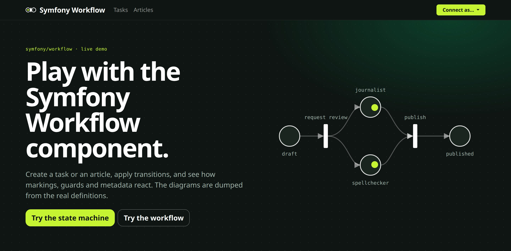

In April 2016, I created a small application for SymfonyLive Paris, to show the new Workflow component. Ten years later, the [demo](https://demo-symfony-workflow.cleverapps.io/) is still online. And it just got a new look.



Why now? I was fed up with the ugly old style.

## What about the style?

The new theme is green, with dark bands. And the diagrams now look like Petri nets, the model behind the Workflow component: black transitions, and marked places in lime.

Bootstrap 5.3.8 and Mermaid come from AssetMapper instead of a CDN. But Mermaid has a funny side effect: its single-file build is not an ES module, so it adds about 125 entries to `importmap.php` (d3, cytoscape…).

125 entries. For a diagram.

That's why it only loads on the pages that show a diagram.

## What's new in the demo?

Applying a transition doesn't reload the page anymore. Turbo morphs it and keeps the scroll. And a small Stimulus controller keeps the diagram on screen until the new one is drawn, so it never goes blank.

But Turbo prefetches the links you hover. And in this demo, logging in and out are GET requests. So just hovering a link would log you in 😅. That's why Turbo doesn't prefetch these two links.

Logged out by your mouse.

The show pages now list the transitions with the guards that block them. And the history shows the last 5 transitions, instead of the first 5.

## What about Symfony 8.2?

The demo runs on Symfony 8.2.0-BETA1, and it uses what's new.

You can now define a workflow in a class, with PHP attributes. Here is a simplified version of the article workflow:

```php
#[AsWorkflow(type: WorkflowType::Workflow, supports: Article::class)]
class ArticleWorkflow
{
    use WorkflowTrait;

    #[Place(initial: true)]
    public const string DRAFT = 'draft';

    #[Transition(
        from: self::DRAFT,
        to: [self::WAITING_FOR_JOURNALIST, self::WAIT_FOR_SPELLCHECKER],
        guard: 'is_fully_authenticated()',
    )]
    public const string REQUEST_REVIEW = 'request review';
}
```

The demo also has five small workflows in YAML, with no class behind them. But a workflow needed a `supports` key, so I had to write this:

```yaml
framework:
    workflows:
        straight:
            type: workflow
            supports:
                - stdClass # Just a hack
```

With 8.2, `supports` is optional, and workflows have their own root key:

```yaml
workflow:
    straight:
        type: workflow
```

The homepage lost its controller too, thanks to the new `template` key of the routes:

```yaml
homepage:
    path: /
    template: homepage/index.html.twig
```

And `bin/console lint:expressions` now checks the guards of the workflows in the CI.

## Conclusion

Go [play with the demo](https://demo-symfony-workflow.cleverapps.io/). Connect as a journalist, apply a transition, and see what happens. And the code is [on GitHub](https://github.com/lyrixx/SFLive-Paris2016-Workflow).
