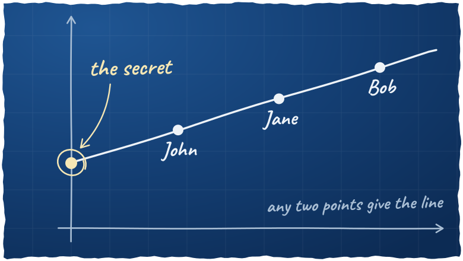
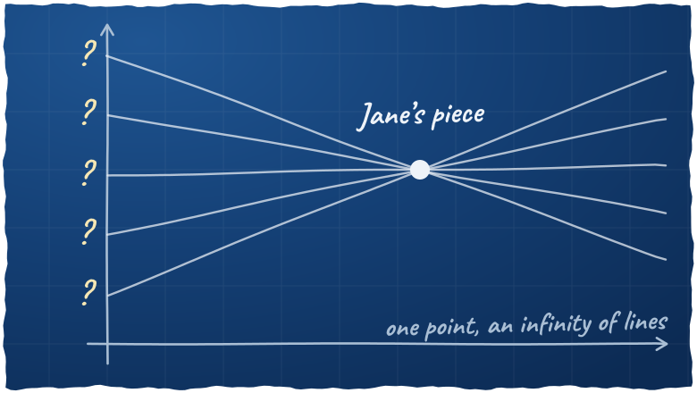
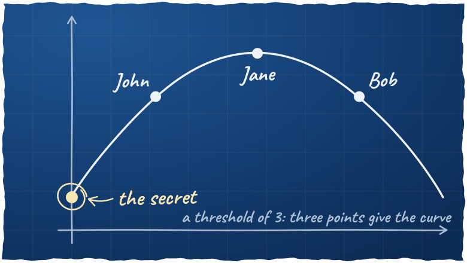
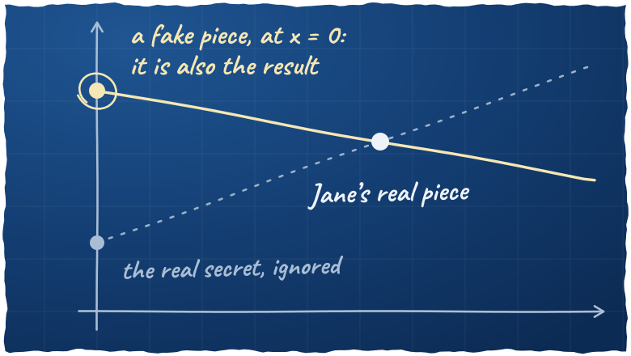

If I lose my phone while traveling, I still need my 2FA recovery codes, my documents and my contacts. That's why I built [private-stuff](https://github.com/lyrixx/private-stuff) in 2024: a static website with everything I may need in an emergency.

Passport, driving license, bank, insurance…

It got a big update this autumn: a new theme, a safer deployment, and above all a way to share a secret with people you trust.

The whole site sits behind a password, and the recovery codes are also encrypted with [staticrypt](https://github.com/robinmoisson/staticrypt). You can see [a demo](https://lyrixx.github.io/private-stuff/) with dummy data.


## What changed on the website?

The site has a new "night light" theme: always dark and warmer, with big Call and Email buttons on the emergency contacts.

The project now has two modes. `dev`, the default, uses dummy data and forbids the deployment. `prod` uses my real data, and the secrets live in a file which is only loaded in this mode. So they can't leak into a `dev` build.

The `encrypt` and `decrypt` tasks now use the native functions of Castor, instead of my hand-written libsodium code.

## What went wrong with the deployment?

The real site is on Cloudflare Pages, with a password in front of it. But deploying from another git branch created a *preview* deployment, which doesn't get the production secrets. So the password was empty, and the middleware let everyone in.

Oups!

Now `castor deploy` always deploys to the production branch. And after the deployment, it checks that the site really asks for a password. If not, the task fails.

The password itself was also sent with a shell `echo`, which exposed it on the command line and in the error output of Castor. It now goes on stdin.

## How to share a secret?

Some things are too sensitive for this website, like a main password or bank accounts. But the people close to you must be able to reach them if something really bad happens.

You could give the password to one person. But then you trust one person, and everything that can happen to this person's laptop. You could also cut it in two halves. But each half reveals a part of the password, and if one half is lost, the password is lost too.

That's what [Shamir's secret sharing](https://en.wikipedia.org/wiki/Shamir%27s_secret_sharing) solves. You split a secret into N pieces, and you choose a threshold K. Any K pieces give the secret, and fewer give nothing.

Adi Shamir, the S of RSA. "How to Share a Secret" is the title of his 1979 paper.

### How can a piece reveal nothing?

Let's take a threshold of 2. Draw a line on a graph, and put your secret where the line crosses the vertical axis. Then give each person a different point of this line.



John + Jane, John + Bob or Jane + Bob: any pair works.

Two points define a line. So two people can draw it, and read the secret. But one point is not enough: an infinity of lines go through it, and they can cross the axis anywhere. So one piece says nothing about the secret. Not "almost nothing": nothing.



With a threshold of 3, you use a parabola, which needs three points. And so on.



A threshold of K: a curve of degree K − 1.

Note: the real implementation works on bytes, in a finite field (GF(2⁸)), not on a graph. But the idea is the same.

### How do you seal a document?

[ReMemory](https://github.com/eljojo/rememory) does the crypto, and private-stuff wraps it in Castor tasks.

First, you write your document in Markdown, in `data/shamir.md`. Then you list the people in `data/shamir.yaml`:

```yaml
threshold: 2
language: fr

holders:
    - name: John Doe
      contact: "+1234567890"
    - name: Jane Smith
      contact: janesmith@example.com
    - name: Bob
```

You check the document, and you seal it:

```bash
castor shamir:preview
castor shamir:seal
```

The task renders the document as an HTML page with no external assets, because it may be opened offline, years later. Then ReMemory encrypts it with [age](https://github.com/FiloSottile/age) and a random passphrase, and splits this passphrase with Shamir:

```
document   ──► encrypted with age ──► the same in every bundle
passphrase ──► split in N pieces  ──► one piece per bundle
```

Each person gets a ZIP bundle, with a `recover.html` page, and a printable `README.pdf` with the instructions, their piece and the contact list.

You send each bundle to its holder, then you delete `var/shamir/`. Together, these bundles open the document, so they must not stay in one place.

If the threshold equals the number of people, the task warns you: a single lost bundle, and nobody can open the document.

### How do they open it?

A holder opens `recover.html` in any browser, offline, with nothing to install. Their own piece is already loaded. They add the bundles of the other holders, until the threshold is reached, and the document opens.

It doesn't depend on ReMemory anymore: the page is self-contained, and it still works if the project disappears.

But any K holders can open the document, without asking you. So choose the people and the threshold carefully.

Choose your friends well.

And if you seal the document again, it creates a new key. The old bundles can't open the new document, so you have to send the new bundles to everyone.

### Is ReMemory safe?

I ran a security audit of ReMemory, with [the security audit skill from Cloudflare](https://github.com/cloudflare/security-audit-skill). It took about 4 hours. Then I shared the results with José Albornoz, its author, and he [patched the library](https://github.com/eljojo/rememory/pull/186) quickly. Thanks José!

There was nothing serious. But one finding is a nice illustration of the line above. The secret is the point at x = 0, so nobody ever gets a piece there. And the recovery didn't check it. With a fake piece at x = 0, the line goes through this point, whatever the other pieces are, so whoever wrote the fake piece chooses the result. They can't learn your real secret, but they could make someone open their files instead of yours.



The real piece changes nothing.

ReMemory now refuses these pieces, and the existing bundles keep working.

## Conclusion

The code is [on GitHub](https://github.com/lyrixx/private-stuff), and the README explains how to build your own, with your own data. And you can try the recovery with [the demo bundles of ReMemory](https://github.com/eljojo/rememory/releases/latest/download/demo-bundles.zip).
