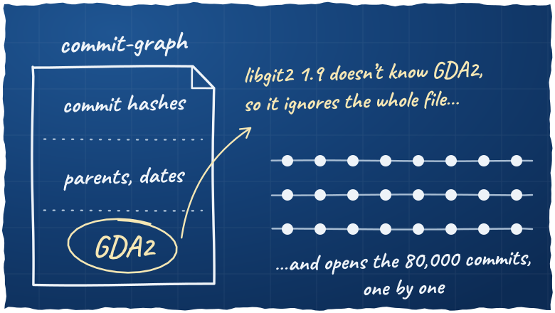
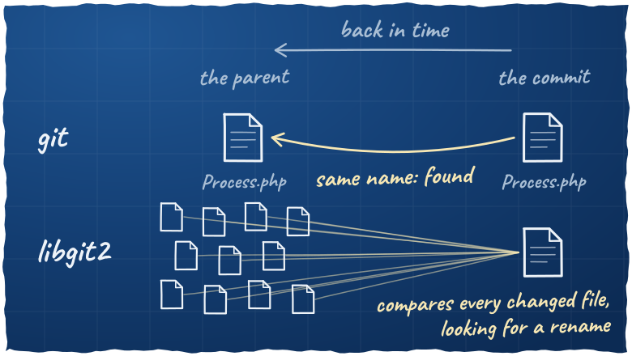

In [gitlib 2.0](/posts/gitlib-2-0-is-out/), a PHP library to read git repositories, I added a driver that runs [libgit2](https://libgit2.org/) inside the PHP process, through FFI. It should be faster than starting `git` for every operation. On a small repository, it is. On symfony/symfony, blaming one file went from 0.6 s to… about 10 minutes.

Yes, minutes.

## Why should it be faster?

Starting a process costs a few milliseconds, every time. With libgit2, there is no process to start. On the gitlib repository (350 commits), reading a commit goes from 3.1 ms to 0.3 ms, and reading a file from 18.5 ms to 0.7 ms.

So far, so good…

## But wait

On symfony/symfony (80,000 commits), it's another story:

- Counting the commits of `HEAD` goes from 43 ms to 1,332 ms
- Listing the branches that include a commit goes from 16 ms to 912 ms
- Blaming `Process.php` goes from 0.6 s to about 10 minutes

WTF! This makes no sense! There must be a mistake somewhere.

That's what I said the first time I saw it. But there is no mistake.

## Why is counting the commits slow?

git writes a summary of the history in a file, the commit-graph: for each commit, its parents and its date. To count the commits, git reads this file. Without it, you have to open every commit, one by one.

libgit2 can read this file too. But git now writes a section in it that libgit2 1.9 doesn't know yet, `GDA2` ([libgit2#7272](https://github.com/libgit2/libgit2/issues/7272)). And when libgit2 finds a section it doesn't know, it ignores the whole file:



Without this section, libgit2 counts the commits of symfony 7 times faster.

## Why is blame slow?

To find who wrote each line of `Process.php`, blame goes back in time, commit after commit. When the file changed in a commit, git takes the previous version in the parent commit, under the same name. libgit2 compares every file the commit changed, in case `Process.php` was renamed. Even when it's right there, with the same name ([libgit2#3027](https://github.com/libgit2/libgit2/issues/3027)):



Comparing files takes time, and libgit2 does it every time the file changed. git looks for a rename only when the file isn't in the parent under the same name.

## Conclusion

In gitlib, `CliDriver`, which runs the `git` binary, stays the default. Use `LibGit2Driver` only if your application runs many small reads in a long-running process.

And don't trust my numbers, try it on your own repository:

```bash
git clone https://github.com/gitonomy/gitlib.git
cd gitlib
composer install
php benchmark.php /path/to/repository path/to/a/file
```
